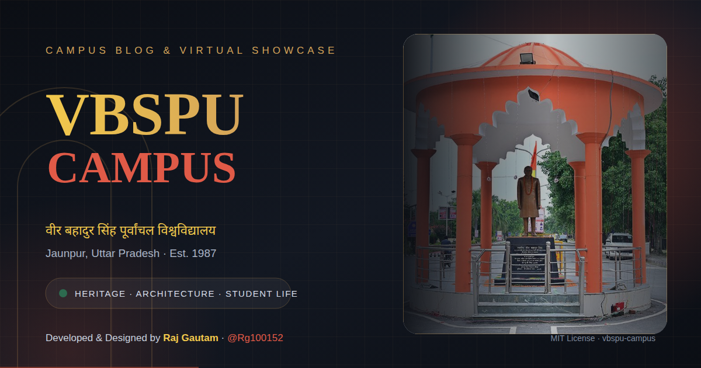
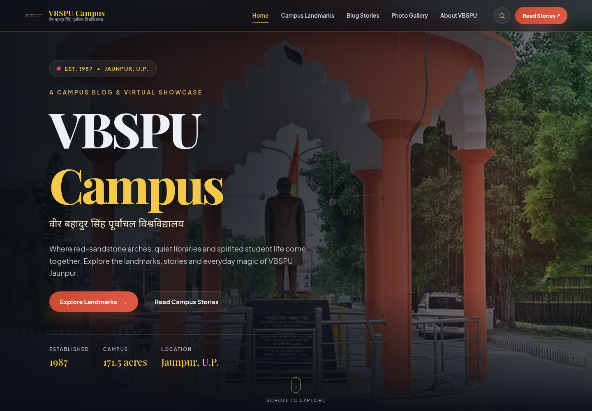
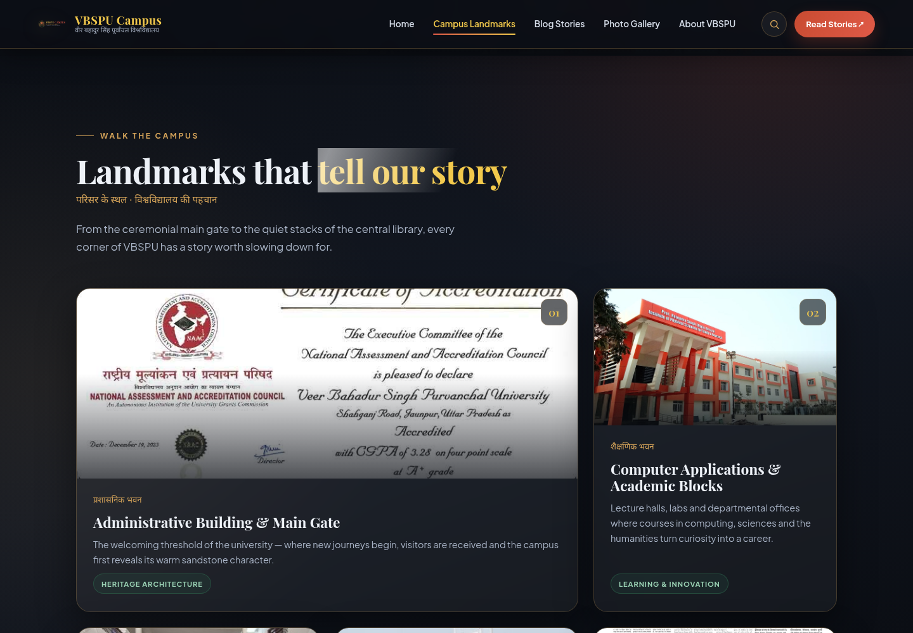
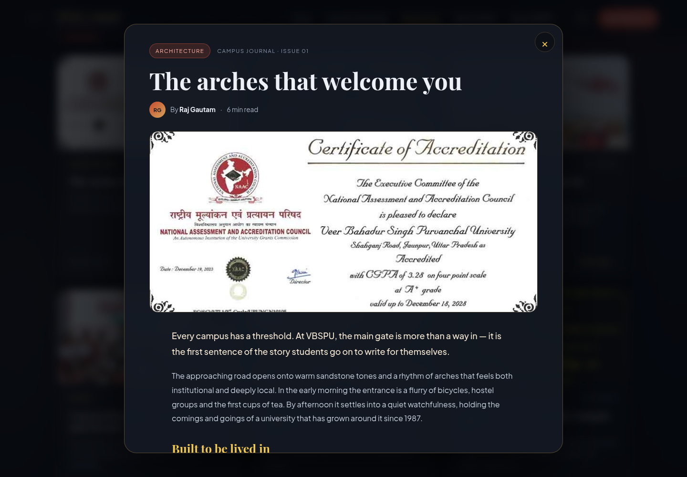
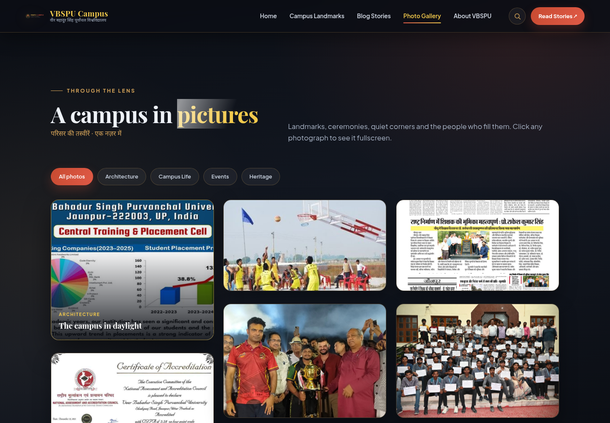

<div align="center">


<a href="https://rg100152.github.io/vbspu-campus/">
  
</a>

# VBSPU Campus

**Campus Blog & Virtual Showcase** of Veer Bahadur Singh Purvanchal University, Jaunpur, Uttar Pradesh.

[](https://developer.mozilla.org/en-US/docs/Web/HTML)
[](https://developer.mozilla.org/en-US/docs/Web/CSS)
[](https://developer.mozilla.org/en-US/docs/Web/JavaScript)
[](https://developer.mozilla.org/en-US/docs/Web/CSS/CSS_media_queries)
[](https://github.com/Rg100152)
[](LICENSE)

[Live Site](https://rg100152.github.io/vbspu-campus/) · [Repository](https://github.com/Rg100152/vbspu-campus) · [Official VBSPU](https://www.vbspu.ac.in/en)

</div>

---

## About the project

VBSPU Campus is an independent, student-made digital tribute to **वीर बहादुर सिंह पूर्वांचल विश्वविद्यालय** — a state university established in 1987 on the Jaunpur–Shahganj road, about 11 km from historic Jaunpur. The site brings together authentic campus photography, short editorial stories and a glassmorphism interface inspired by the university's terracotta arches, warm gold domes and evening charcoal sky.

It is built with **semantic HTML5, modern CSS3 and vanilla JavaScript** — no framework, no build step, fast to load and easy to host on GitHub Pages.

### Theme highlights

- 🏛️ **Heritage architecture** — main gate, administrative block, academic buildings and auditorium
- 📚 **Knowledge spaces** — Vivekananda Central Library and research institutes
- 🏟️ **Sports & spirit** — Eklavya Stadium, cricket finals and campus tournaments
- 🌿 **Campus life** — hostels, gardens, student gatherings and Jaunpur's heritage nearby
- ✨ **Dark glass UI** — blurred glass cards, terracotta/gold palette, bilingual headings, scroll-reveal and parallax

## Features

| Feature | Details |
|---|---|
| Sticky glass navbar | Transparent blur, active-section tracking, mobile menu and quick search |
| Cinematic hero | Full-viewport campus photograph, bilingual title, floating glass badge and parallax |
| Landmark cards | Five interactive glass cards covering the campus essentials |
| Campus journal | Category filters (Architecture, Student Life, Events, Heritage) with a full article reader modal |
| Photo gallery | Filterable masonry layout with a keyboard-accessible fullscreen lightbox |
| Micro-interactions | IntersectionObserver reveals, 3D card tilt, hover glows and reduced-motion support |
| Developer credits | Footer with GitHub, BCA department and MIT license links |

## Screenshots

| Hero | Campus landmarks |
|:---:|:---:|
|  |  |

| Blog article reader | Photo gallery |
|:---:|:---:|
|  |  |

> Screenshots were captured at 1440 × 1000 with headless Chrome while serving the site locally.

## Folder structure

```text
vbspu-campus/
├── index.html                  # Semantic markup for all sections
├── css/
│   ├── style.css               # Design system, layout, components, responsive rules
│   └── animations.css          # Reveal, parallax and tilt motion layer
├── js/
│   ├── main.js                 # Nav, quick search, reveals, tilt, parallax
│   ├── blog-modal.js           # Stories, category filters and article reader
│   └── gallery-lightbox.js     # Masonry filters and fullscreen lightbox
├── assets/
│   ├── images/
│   │   ├── logo.svg            # Custom VBSPU Campus emblem
│   │   ├── banner.svg          # Editable GitHub banner source
│   │   ├── banner.png          # Rendered README banner
│   │   └── campus/             # Authentic VBSPU photos + ATTRIBUTION.md
│   └── screenshots/            # Automated UI screenshots
├── README.md
├── LICENSE                     # MIT License
└── .gitignore
```

## Setup

```bash
# Clone
git clone https://github.com/Rg100152/vbspu-campus.git
cd vbspu-campus

# Serve locally (no dependencies or build step)
python3 -m http.server 8080
# Then open http://localhost:8080
```

Any static server works — for example `npx serve .` or the VS Code Live Server extension.

## Image credits

Photographs are authentic VBSPU / Jaunpur imagery sourced from Wikimedia Commons (CC BY-SA 4.0) and the official VBSPU website, and are used here for an educational showcase with attribution. Full per-file credits and source links live in [`assets/images/campus/ATTRIBUTION.md`](assets/images/campus/ATTRIBUTION.md). The emblem and banner are original project artwork.

## License

Released under the [MIT License](LICENSE). Copyright © 2026 Raj Gautam.

---

<div align="center">

**Developed & Designed by [Raj Gautam](https://github.com/Rg100152)** (`Rg100152`)  
Department of Computer Applications (BCA) · VBSPU, Jaunpur

*Built with ♥ for the VBSPU campus community.*

</div>
